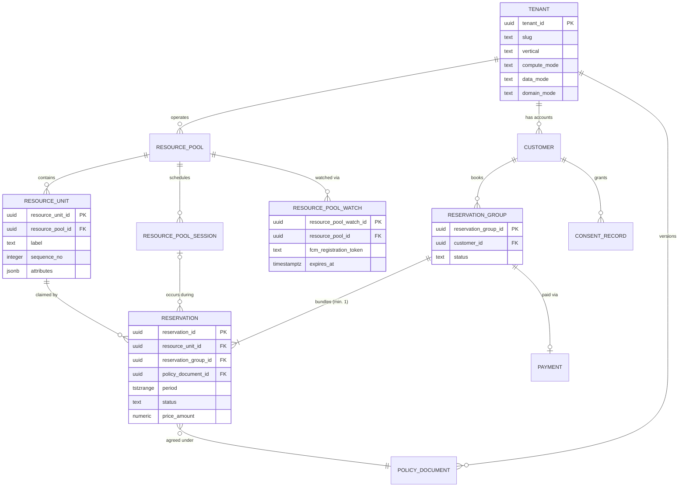
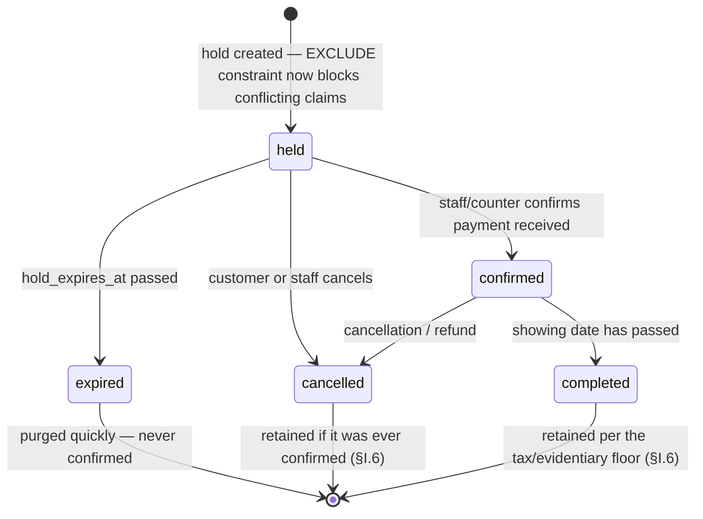

# Cinema Seat Reservation Platform — Build Specification

> The build specification for this platform: data model, multi-tenancy, stack, concurrency analysis, Indonesian legal notes and a phased build plan.
> Written for the original deployment and published as written on 2026-11-04, apart from real cinema, chain and prospect names (now pseudonyms such as "Cinema A" and "Chain A") and references to private documents, which are removed. Hosting and build-mode passages describe that original design, not necessarily this repository. Not legal advice.

**Quarkus (Mandrel native image) + PostgreSQL 18 on Cloud Run · Qute + HTMX server-rendered client · plain JDBC, no ORM**

This is a build specification for a solo-maintained, multi-tenant reservation SaaS. The first tenant is a real cinema; the schema is deliberately generic enough to also serve hospitality (room-date) reservations without a redesign, but only the cinema/ticketing UI ships in the MVP. Every decision below states its reasoning inline — implement the reasoning, not just the artifact, since several of these decisions are easy to accidentally undo by "simplifying" during implementation.

---

## Contents

- Part I.0 — MVP use cases
- Part I.1 — Data model
- Part I.2 — Multi-tenancy
- Part I.3 — Technology stack
- Part I.4 — Realtime availability push
- Part I.5 — Concurrency correctness (constraints, isolation, and a full anomaly audit)
- Part I.6 — Indonesian legal requirements
- Part I.7 — Business operations: billing and cost
- Part II — Phased build plan

---

## Executive summary

**Scope.** Ticketing (cinema) only, end to end. Hospitality reuses the same schema later but isn't built out as a product yet. Customer flow: browse showtimes → live seat map → hold a seat or small contiguous block → confirm to a reservation, paid at the counter (no payment integration yet) → cancel. Tenant flow: configure a hall's seat map once, create/manage showings, manually release or cancel a reservation. Nothing else — refund variants, pricing tiers, loyalty — is in scope until this is proven with a real tenant.

**Client.** Quarkus Qute + HTMX, server-rendered. One deployable, one release cycle, no app-store review gate. No native app for this phase.

**Data access.** Plain JDBC via Agroal's `DataSource`, no ORM or SQL query-builder. Every query is written and tested directly against the schema before it goes into Java code, and covered by an integration test that runs it against a real, migrated PostgreSQL instance — this is what actually catches a wrong column name or bad syntax, not the compiler. Detail and reasoning in §I.3.

**Correctness mechanism.** A PostgreSQL `EXCLUDE` constraint over `(resource_unit_id, period)` makes double-booking structurally impossible, independent of isolation level. `SERIALIZABLE` is reserved for the one place this schema actually needs it — a cross-row aggregate check — and a separate, non-isolation-level fix (row locking at write time) closes a gap no isolation level can touch. Full audit against Adya's anomaly taxonomy in §I.5.

**Hosting.** Cloud Run, region `asia-southeast2` (Jakarta) — resolves latency and Indonesian data-residency questions without needing a legal ruling to get there. Cloud SQL for PostgreSQL 18, same region. Build mode: Mandrel/GraalVM native image, not JVM — Cloud Run's startup CPU boost doubles vCPU allocation for the entire cold-start window plus 10 seconds afterward, so a slow startup is billed at double rate for longer, not just for longer; native's sub-second startup wins this decisively at low, bursty traffic. Detail, numbers, and the exact switch-back condition in §I.3.

**Realtime.** Failed booking attempts are answered synchronously, in the same HTTP response — no separate channel needed. Availability updates to other customers watching a seat map go out via the browser Push API, using Firebase Cloud Messaging as the push service, backed by a database table rather than a held-open connection or an in-memory registry — the only shape that fits Cloud Run's multi-instance, scale-to-zero model without fighting it.

**Legal entity.** A sole-founder PT (*Perseroan Perorangan*) — Indonesia's single-founder limited-liability company, under UU 6/2023 Pasal 153A — registers before any tenant is invoiced. Detail in §I.6.

**Billing.** Flat monthly tiers to tenants, not per-ticket and not metered — matching the same "don't build coordination machinery a benefit doesn't justify yet" principle applied throughout. The platform's own Cloud bill gets tenant-labeled resources, a budget alert, and a hard instance ceiling from day one.

---

## Assumptions

1. Tenants are Indonesia-domiciled, serving Indonesian customers — this is what makes §I.6 the controlling legal frame. A non-Indonesia tenant later needs a jurisdiction flag, already present as `tenant.jurisdiction`.
2. One vertical ships as a product: ticketing. Hospitality stays schema-generic (§I.1) but has no UI yet.
3. Customer accounts are tenant-scoped, not shared platform-wide identity.
4. No payment integration yet. A confirmed reservation means "pay at the counter." QRIS lands once the core double-booking guarantee is proven live.
5. Hosting is Google Cloud, `asia-southeast2`.

---

## Part I — Design

## I.0 MVP use cases

**Customer-facing:**

1. Browse showtimes for a venue.
2. View a live seat map for one showing — computed directly against `held`/`confirmed` rows for that showing's units, never a static or cached image.
3. Select a seat, or a small contiguous block, and hold it.
4. Confirm the hold into a reservation. No payment step yet — the reservation itself, plus the constraint that makes it exclusive, is the entire value proposition being proven.
5. Cancel a held or confirmed reservation.

**Tenant-facing (cinema staff):**

1. Configure a hall's seat map — enter its `resource_unit` rows once; every hall's layout differs.
2. Create and manage a showing — a film, a start time, a hall.
3. Manually release or cancel a reservation — phone cancellations and no-shows are a real, everyday operational need, not deferrable.
4. **Sell at the counter, on behalf of a walk-in customer.** Not an edge case: on-the-spot counter sales are the dominant channel at Indonesian cinemas (Cinema A, a prospective tenant and Chain A alike), and a system that only handles online self-service would cover the minority of a tenant's actual transactions. Staff select seats for a showing, create the hold, then settle payment one of two ways — mark it paid manually for cash, or display a dynamic QRIS QR summed to the exact ticket total for the customer to scan, letting the payment webhook confirm it automatically. The schema already anticipates this: `reservation.created_by_actor` accepts `'tenant_staff'`, and `audit_log.actor_type` mirrors it, so a counter sale is distinguishable from a self-service booking in the record without special-casing.

**Walk-in customers usually have no identity**, which the schema as written can't represent — `reservation_group.customer_id` is `NOT NULL` and `customer.full_name` is `NOT NULL`, but someone paying cash for two tickets leaves no email and wants no account. Resolved with a per-tenant "Walk-in" placeholder `customer` row, created at tenant provisioning, that counter sales attach to — deliberately preferred over making `customer_id` nullable, which would mean every query and report joining through `customer` needs a null branch forever. The placeholder keeps the FK graph and the `NOT NULL` guarantees intact, and counter sales show up in the same queries as everything else.

**On the payment mechanism for counter sales specifically:** this is the same QRIS integration as the customer-facing flow, triggered from the staff side — not a second integration. An EDC terminal (the physical card reader a cinema gets from its acquiring bank) is a different rail entirely and isn't part of this design; the QR-on-a-counter-screen approach reuses what already exists.

**Explicitly out of scope:** refund-policy variants, seat-category pricing tiers, loyalty programs, native apps for Android or iOS, EDC/card-terminal integration.

## I.1 Data model

### The mechanism everything else supports

A theater seat held for one showing and a hotel room held for a date range are the same problem stated precisely: an exclusive claim on a resource, for a period, where two overlapping claims cannot both stand. PostgreSQL has a native, atomic mechanism for exactly this — an `EXCLUDE` constraint over a range type. It is the load-bearing element of this schema; most other tables exist to support it or record what happened around it.

### Vertical mapping

| Table / column | Ticketing (ships now) | Hospitality (schema-ready, no UI) |
|---|---|---|
| `resource_pool` | The venue (hall) | The property |
| `resource_unit` | A seat | A room |
| `resource_pool.block_claim_mode` | `'contiguous_n'` | `'all_units'` |
| `resource_unit.label` / `.sequence_no` | Seat number (label, may be alphanumeric like "12A"); plain integer (sequence_no) for contiguous-block arithmetic | Room number (label); sequence_no unused |
| `resource_pool_session` | One row per showing | Unused — no discrete "occasions" in hospitality |
| `reservation.period` | `[event_start, event_end)` | `[check_in, check_out)` |
| `reservation_group` | One seat, or an N-seat contiguous block | One room, or an N-room block |
| `payment` | References `reservation_group_id` always, never `reservation_id` — avoids a polymorphic FK | Same |

### Design decisions and their reasoning

**One table for "held" and "reservation," not two, with a status column.** PostgreSQL cannot enforce a single `EXCLUDE` constraint across two tables. The double-booking guarantee only holds if holds and confirmed reservations are checked against each other in one constraint — `status IN ('held','confirmed','cancelled','expired','completed')` plus a partial `EXCLUDE ... WHERE (status IN ('held','confirmed'))`.

**Every reservation belongs to a `reservation_group`, even a single seat ("a group of one").** Avoids a polymorphic `payment.bookable_type` column; one all-or-nothing confirmation concept covers both a single seat and a contiguous block.

**`resource_pool.block_claim_mode` is an explicit enum**, not something inferred from `tenant.vertical` in application code — costs one column, avoids tribal knowledge.

**`tenant_id` on every tenant-scoped table, even where a join could derive it** — `reservation.tenant_id` is technically redundant with `resource_unit_id → resource_pool_id → tenant_id`, but Postgres row-level security needs `tenant_id` directly on the row to evaluate cheaply; without it, every RLS check becomes a multi-table join, or two schema variants have to be maintained forever. Applied consistently on every child table below `tenant` in the FK graph — `resource_unit`, `resource_pool_session`, `reservation_group`, `payment`, `resource_pool_watch`, `consent_record`, and `customer_pii`. No table is the exception, including `customer_pii`, which holds the most sensitive data and should be the last table to skip this pattern, not a candidate for it.

**`sequence_no` is a plain integer, not text.** Contiguous-seat search needs arithmetic (`BETWEEN`, `= previous + 1`); string comparison breaks the moment a hall skips a seat/row number, or once any label reaches two digits ("10" sorts before "9" as text).

**Pricing lives in a `jsonb rule_definition` (`rate_rule`), not rigid columns.** Ticketing wants flat or seat-category pricing; hospitality wants seasonal nightly rates. Forcing one rigid shape fits one vertical and distorts the other. The part of the domain that has to be bulletproof — the claim itself, its exclusivity, all-or-nothing bundling — stays in strict relational columns; pricing, which is genuinely vertical-specific, is allowed to be.

**A booking-time policy snapshot (`policy_document`), separate from account-level `terms_version`.** `terms_version` is what a customer accepts once at signup. `policy_document` is what governs one specific booking — its cancellation policy, specifically — and `reservation.policy_document_id` freezes which version was in effect at booking time, so a tenant editing their cancellation policy next month can never retroactively change what an earlier customer agreed to.

### Entity relationships



### DDL

Ordered to satisfy foreign-key dependencies — runs top to bottom without error. Every query the application issues against these tables must be run directly against a migrated instance of this schema and verified before being written into Java (§I.3) — this DDL is the ground truth, not the Java code that queries it.

```sql
CREATE EXTENSION IF NOT EXISTS pgcrypto;
CREATE EXTENSION IF NOT EXISTS btree_gist;

-- Control plane: shared regardless of a tenant's own data_mode. Deliberately the one
-- table NOT tenant-isolated, because it's what implements isolation for everything else.
CREATE TABLE tenant (
    tenant_id            uuid PRIMARY KEY DEFAULT gen_random_uuid(),
    slug                 text NOT NULL UNIQUE,
    display_name         text NOT NULL,
    vertical             text NOT NULL CHECK (vertical IN ('hospitality','live_entertainment')),
    compute_mode         text NOT NULL DEFAULT 'shared'    CHECK (compute_mode IN ('shared','dedicated')),
    data_mode            text NOT NULL DEFAULT 'shared'    CHECK (data_mode    IN ('shared','dedicated')),
    domain_mode          text NOT NULL DEFAULT 'subdomain' CHECK (domain_mode  IN ('subdomain','custom')),
    custom_domain        text UNIQUE,
    dedicated_db_host    text,
    dedicated_db_name    text,
    jurisdiction         text NOT NULL DEFAULT 'ID',
    complaint_phone      text NOT NULL,
    pse_registration_no  text,
    status               text NOT NULL DEFAULT 'active' CHECK (status IN ('active','suspended','offboarding')),
    created_at           timestamptz NOT NULL DEFAULT now(),
    CONSTRAINT dedicated_fields_consistent CHECK (
        (data_mode = 'dedicated' AND dedicated_db_host IS NOT NULL AND dedicated_db_name IS NOT NULL)
        OR (data_mode = 'shared' AND dedicated_db_host IS NULL AND dedicated_db_name IS NULL)
    )
);

CREATE TABLE resource_pool (
    resource_pool_id  uuid PRIMARY KEY DEFAULT gen_random_uuid(),
    tenant_id         uuid NOT NULL REFERENCES tenant(tenant_id),
    name              text NOT NULL,
    address           text,
    timezone          text NOT NULL DEFAULT 'Asia/Jakarta',
    block_claim_mode  text NOT NULL DEFAULT 'none' CHECK (block_claim_mode IN ('none','all_units','contiguous_n')),
    created_at        timestamptz NOT NULL DEFAULT now()
);

CREATE TABLE resource_unit (
    resource_unit_id  uuid PRIMARY KEY DEFAULT gen_random_uuid(),
    tenant_id         uuid NOT NULL REFERENCES tenant(tenant_id),
    resource_pool_id  uuid NOT NULL REFERENCES resource_pool(resource_pool_id),
    label             text NOT NULL,
    group_key         text,
    sequence_no       integer,
    attributes        jsonb NOT NULL DEFAULT '{}',
    is_active         boolean NOT NULL DEFAULT true,
    created_at        timestamptz NOT NULL DEFAULT now()
);
CREATE INDEX idx_resource_unit_pool ON resource_unit(resource_pool_id);
CREATE INDEX idx_resource_unit_adjacency ON resource_unit(resource_pool_id, group_key, sequence_no);

CREATE TABLE resource_pool_session (
    resource_pool_session_id  uuid PRIMARY KEY DEFAULT gen_random_uuid(),
    tenant_id                 uuid NOT NULL REFERENCES tenant(tenant_id),
    resource_pool_id          uuid NOT NULL REFERENCES resource_pool(resource_pool_id),
    label                     text NOT NULL,
    starts_at                 timestamptz NOT NULL,
    ends_at                   timestamptz NOT NULL,
    sales_cutoff_at           timestamptz,
    status                    text NOT NULL DEFAULT 'scheduled' CHECK (status IN ('scheduled','on_sale','closed','cancelled')),
    created_at                timestamptz NOT NULL DEFAULT now()
);

CREATE TABLE terms_version (
    terms_version_id  uuid PRIMARY KEY DEFAULT gen_random_uuid(),
    tenant_id         uuid NOT NULL REFERENCES tenant(tenant_id),
    version_label     text NOT NULL,
    content_hash      text NOT NULL,
    effective_from    timestamptz NOT NULL,
    created_at        timestamptz NOT NULL DEFAULT now()
);

CREATE TABLE customer (
    customer_id                uuid PRIMARY KEY DEFAULT gen_random_uuid(),
    tenant_id                  uuid NOT NULL REFERENCES tenant(tenant_id),
    full_name                  text NOT NULL,
    phone                      text,
    email                      text,
    date_of_birth_attested     boolean NOT NULL DEFAULT false,
    terms_accepted_version_id  uuid REFERENCES terms_version(terms_version_id),
    terms_accepted_at          timestamptz,
    created_at                 timestamptz NOT NULL DEFAULT now()
);

-- Immutable, versioned booking-time policy snapshot. reservation.policy_document_id
-- points at the exact version in effect when that booking was made.
CREATE TABLE policy_document (
    policy_document_id  uuid PRIMARY KEY DEFAULT gen_random_uuid(),
    tenant_id           uuid NOT NULL REFERENCES tenant(tenant_id),
    doc_type            text NOT NULL CHECK (doc_type IN ('terms','cancellation_policy','privacy')),
    version             integer NOT NULL,
    content             text NOT NULL,
    effective_from      timestamptz NOT NULL DEFAULT now(),
    UNIQUE (tenant_id, doc_type, version)
);

CREATE TABLE rate_rule (
    rate_rule_id      uuid PRIMARY KEY DEFAULT gen_random_uuid(),
    tenant_id         uuid NOT NULL REFERENCES tenant(tenant_id),
    resource_pool_id  uuid NOT NULL REFERENCES resource_pool(resource_pool_id),
    rule_definition   jsonb NOT NULL,
    effective_from    timestamptz NOT NULL DEFAULT now(),
    effective_to      timestamptz
);

CREATE TABLE reservation_group (
    reservation_group_id     uuid PRIMARY KEY DEFAULT gen_random_uuid(),
    tenant_id                uuid NOT NULL REFERENCES tenant(tenant_id),
    resource_pool_id         uuid NOT NULL REFERENCES resource_pool(resource_pool_id),
    customer_id              uuid NOT NULL REFERENCES customer(customer_id),
    requested_unit_count     integer NOT NULL DEFAULT 1,
    status                   text NOT NULL DEFAULT 'pending' CHECK (status IN ('pending','confirmed','failed','cancelled')),
    failed_resource_unit_id  uuid REFERENCES resource_unit(resource_unit_id),
    created_at               timestamptz NOT NULL DEFAULT now(),
    confirmed_at             timestamptz
);

-- THE CORE: the exclusion constraint that makes double-booking structurally
-- impossible, not merely checked-for.
CREATE TABLE reservation (
    reservation_id            uuid PRIMARY KEY DEFAULT gen_random_uuid(),
    tenant_id                 uuid NOT NULL REFERENCES tenant(tenant_id),
    reservation_group_id      uuid NOT NULL REFERENCES reservation_group(reservation_group_id),
    resource_unit_id          uuid NOT NULL REFERENCES resource_unit(resource_unit_id),
    resource_pool_session_id  uuid REFERENCES resource_pool_session(resource_pool_session_id),
        -- also load-bearing for the realtime notify step in §I.4, which needs this to know
        -- which session's watchers to look up
    policy_document_id        uuid REFERENCES policy_document(policy_document_id),
    period                    tstzrange NOT NULL,
    status                    text NOT NULL DEFAULT 'held' CHECK (status IN ('held','confirmed','cancelled','expired','completed')),
    price_amount              numeric(14,2) NOT NULL,
    price_currency            text NOT NULL DEFAULT 'IDR',
    hold_expires_at           timestamptz,
    idempotency_key           uuid,
    created_by_actor          text NOT NULL DEFAULT 'customer' CHECK (created_by_actor IN ('customer','tenant_staff','system')),
    confirmed_at              timestamptz,
    cancelled_at              timestamptz,
    cancellation_reason       text,
    created_at                timestamptz NOT NULL DEFAULT now(),
    updated_at                timestamptz NOT NULL DEFAULT now(),
    CONSTRAINT reservation_no_overlap
        EXCLUDE USING gist (resource_unit_id WITH =, period WITH &&)
        WHERE (status IN ('held','confirmed'))
);
CREATE INDEX idx_reservation_group ON reservation(reservation_group_id);
CREATE INDEX idx_reservation_status_expiry ON reservation(status, hold_expires_at) WHERE status = 'held';
CREATE UNIQUE INDEX idx_reservation_idempotency ON reservation(tenant_id, idempotency_key) WHERE idempotency_key IS NOT NULL;
    -- this index is what actually enforces the guarantee an idempotency key is supposed to
    -- provide; the column alone doesn't stop a retried request from double-booking

-- Realtime subscription registry — replaces what an in-memory registry or LISTEN/NOTIFY
-- would otherwise need; neither fits Cloud Run's scale-to-zero, multi-instance model.
CREATE TABLE resource_pool_watch (
    resource_pool_watch_id    uuid PRIMARY KEY DEFAULT gen_random_uuid(),
    tenant_id                 uuid NOT NULL REFERENCES tenant(tenant_id),
    resource_pool_id          uuid NOT NULL REFERENCES resource_pool(resource_pool_id),
    resource_pool_session_id  uuid REFERENCES resource_pool_session(resource_pool_session_id),
    customer_id               uuid REFERENCES customer(customer_id),
    fcm_registration_token    text NOT NULL,
    registered_at             timestamptz NOT NULL DEFAULT now(),
    expires_at                timestamptz NOT NULL DEFAULT (now() + interval '20 minutes')
        -- a safety net, not the primary cleanup path: the client deletes its own watch
        -- when the seat-map page closes; this only catches crashes and dropped connections
);
CREATE UNIQUE INDEX idx_resource_pool_watch_dedupe ON resource_pool_watch (
    resource_pool_id,
    COALESCE(resource_pool_session_id, '00000000-0000-0000-0000-000000000000'::uuid),
    fcm_registration_token
);
CREATE INDEX idx_resource_pool_watch_lookup ON resource_pool_watch (resource_pool_id, resource_pool_session_id, expires_at);

CREATE TABLE payment (
    payment_id                  uuid PRIMARY KEY DEFAULT gen_random_uuid(),
    tenant_id                   uuid NOT NULL REFERENCES tenant(tenant_id),
    reservation_group_id        uuid NOT NULL REFERENCES reservation_group(reservation_group_id),
    amount                      numeric(14,2) NOT NULL,
    currency                    text NOT NULL DEFAULT 'IDR',
    qris_merchant_id            text NOT NULL,
    qris_terminal_id            text NOT NULL,
    qris_partner_reference_no   text NOT NULL UNIQUE,
    qris_content                text,
    qris_reference_no           text,
    status                      text NOT NULL DEFAULT 'pending' CHECK (status IN ('pending','paid','expired','failed','refunded')),
    expires_at                  timestamptz NOT NULL,
    paid_at                     timestamptz,
    webhook_received_at         timestamptz,
    webhook_signature_verified  boolean NOT NULL DEFAULT false,
    raw_webhook_payload         jsonb,
    created_at                  timestamptz NOT NULL DEFAULT now()
);

CREATE TABLE tenant_billing_period (
    tenant_billing_period_id  uuid PRIMARY KEY DEFAULT gen_random_uuid(),
    tenant_id                 uuid NOT NULL REFERENCES tenant(tenant_id),
    period_start              date NOT NULL,
    period_end                date NOT NULL,
    plan_tier                 text NOT NULL,
    amount_due                numeric(12,2) NOT NULL,
    currency                  text NOT NULL DEFAULT 'IDR',
    status                    text NOT NULL DEFAULT 'pending' CHECK (status IN ('pending','invoiced','paid','overdue')),
    invoiced_at               timestamptz,
    paid_at                   timestamptz,
    payment_reference         text,
    UNIQUE (tenant_id, period_start, period_end)
);

CREATE TABLE consent_record (
    consent_id            uuid PRIMARY KEY DEFAULT gen_random_uuid(),
    tenant_id             uuid NOT NULL REFERENCES tenant(tenant_id),
    customer_id           uuid NOT NULL REFERENCES customer(customer_id),
    purpose               text NOT NULL,
    legal_basis           text NOT NULL CHECK (legal_basis IN ('contract','consent','legal_obligation','vital_interest','public_task')),
    consent_given_at      timestamptz,
    consent_withdrawn_at  timestamptz,
    policy_text_hash      text NOT NULL,
    ip_address            inet,
    created_at            timestamptz NOT NULL DEFAULT now()
);

CREATE TABLE customer_pii (
    customer_id      uuid PRIMARY KEY REFERENCES customer(customer_id),
    tenant_id        uuid NOT NULL REFERENCES tenant(tenant_id),
    full_address     text,
    id_document_ref  text,
    deleted_at       timestamptz
);

CREATE TABLE audit_log (
    audit_id        bigserial PRIMARY KEY,
    tenant_id       uuid NOT NULL REFERENCES tenant(tenant_id),
    entity_type     text NOT NULL,
    entity_id       uuid NOT NULL,
    action          text NOT NULL,
    actor_type      text NOT NULL CHECK (actor_type IN ('customer','tenant_staff','system','agen_elektronik')),
    actor_id        uuid,
    occurred_at     timestamptz NOT NULL DEFAULT clock_timestamp(),
    previous_state  jsonb,
    new_state       jsonb,
    request_id      uuid,
    row_hash        text NOT NULL
        -- a hash chain, not a per-row hash — see the trigger function below for why
        -- that distinction matters and how it's computed
);
CREATE INDEX idx_audit_entity ON audit_log(tenant_id, entity_type, entity_id, occurred_at);
-- REVOKE UPDATE, DELETE, TRUNCATE ON audit_log FROM app_role;
-- GRANT SELECT, INSERT ON audit_log TO app_role;

-- A hash of a row's own content proves that row wasn't altered after the fact — it does
-- NOT prove nothing was deleted from or reordered within the sequence, since nothing links
-- one row to the next. Folding the previous row's hash into each new row's hash input is
-- what turns per-row tamper-evidence into a genuine chain: altering or removing any
-- historical row breaks verification for everything after it, not just for that one row.
CREATE OR REPLACE FUNCTION reservation_audit() RETURNS trigger AS $$
DECLARE
    prior_hash text;
BEGIN
    SELECT row_hash INTO prior_hash
    FROM audit_log
    WHERE tenant_id = COALESCE(NEW.tenant_id, OLD.tenant_id)
    ORDER BY audit_id DESC
    LIMIT 1;   -- chained per tenant, not globally: a dedicated-tenant database only ever
               -- holds its own rows anyway, and a global chain would leak cross-tenant ordering

    INSERT INTO audit_log(tenant_id, entity_type, entity_id, action, actor_type, previous_state, new_state, row_hash)
    VALUES (
        COALESCE(NEW.tenant_id, OLD.tenant_id), 'reservation',
        COALESCE(NEW.reservation_id, OLD.reservation_id), TG_OP,
        COALESCE(NEW.created_by_actor, 'system'),
        CASE WHEN TG_OP <> 'INSERT' THEN to_jsonb(OLD) END,
        CASE WHEN TG_OP <> 'DELETE' THEN to_jsonb(NEW) END,
        encode(digest(   -- the content's HASH, not the content: see "Verifying" below
            COALESCE(prior_hash, '') || encode(digest(audit_content(<this row>), 'sha256'), 'hex'),
            'sha256'
        ), 'hex')
    );
    RETURN COALESCE(NEW, OLD);
END;
$$ LANGUAGE plpgsql;

CREATE TRIGGER reservation_audit
AFTER INSERT OR UPDATE OR DELETE ON reservation
FOR EACH ROW EXECUTE FUNCTION reservation_audit();

-- Row-level security: identical ENABLE/FORCE/POLICY block on every tenant-scoped table
-- above (all except tenant itself). Shown once here, apply to each.
ALTER TABLE reservation ENABLE ROW LEVEL SECURITY;
ALTER TABLE reservation FORCE ROW LEVEL SECURITY;
CREATE POLICY tenant_isolation ON reservation
    USING (tenant_id = current_setting('app.current_tenant_id', true)::uuid);
```

**On `period`:** simplified to midnight-boundary dates for hospitality's case; for ticketing, populated as the showing's actual start/end timestamps. The exclusion constraint only cares about range overlap, so this is safe regardless of how fine-grained the boundaries are.

**Verifying the audit hash chain later** is a walk in `audit_id` order: each row's hash is `sha256_hex(previous row_hash || sha256_hex(audit_content(row)))`, where `audit_content` is the row's JSON text over every column but `audit_id` and `row_hash` (who acted and when included), and the first row's previous hash is empty. Any mismatch is exactly the tamper this is built to catch. **A gap in `audit_id` is not**: an identity value is spent by any transaction that rolls back after an audited write, so gaps occur in ordinary traffic; a deleted row shows as a broken link, never as a missing number.

Because the chain links content *hashes*, one order can be proven without disclosing the tenant's other bookings: the rows between it and the chain's head go to the verifier as their content hash alone, and the walk still verifies (`AuditLogRepositoryTest`). And because the operator could recompute the whole chain, each tenant's head is timestamped hourly by an RFC 3161 authority (`audit_anchor`, `AuditAnchorService`). A reply pins every row up to it, and `openssl ts -verify -digest <that row_hash> -in reply.tsr -CAfile <the authority's root>` checks it with nothing from the operator but the files.

### Reservation lifecycle



**`confirmed → completed` is also the revenue-recognition boundary, not merely a housekeeping transition.** A `confirmed` reservation whose `period` is still in the future is a contract liability on the tenant's books — money received for a showing not yet delivered — and only becomes earned revenue once that showing has passed (§I.6). This matters in two concrete places: any tenant-facing reporting must not total confirmed-but-unplayed bookings as revenue, and this transition is what makes that distinction computable from status alone rather than requiring date arithmetic at every call site.

**Worth verifying before any reporting is built: does anything actually perform this transition?** `held → expired` has a scheduled sweep behind it. `confirmed → completed` may not — in which case `completed` exists in the `CHECK` constraint and the diagram above but is never set on a real row, and the revenue boundary has no mechanism. Cheap to add as a second pass in the same scheduled job that already sweeps expired holds; expensive to discover after a tenant's first month-end.

### The genericity claim, stress-tested

Against a plausible third vertical — co-working desk booking — without changing a single `CREATE TABLE` statement: `resource_pool` → the co-working space; `resource_unit` → a desk; `resource_pool_session` → unused; `reservation.period` → sub-day `tstzrange`, a UI change only. Block booking → `reservation_group` with `requested_unit_count` set accordingly. The one genuine gap: this schema assumes a customer always claims a *specific* `resource_unit`; it has no concept of *unassigned*-capacity booking ("any available desk today"), which would need a pool-level capacity counter — a genuinely different mechanism, not a new row in the existing one.

---

## I.2 Multi-tenancy

Three independent axes — compute, data, domain — modeled as three columns on `tenant`, sold as named packages on a pricing page, with the schema itself staying orthogonal underneath regardless of how packaging changes.

| Combination | Sold as |
|---|---|
| shared / shared / subdomain | Starter |
| shared / dedicated-DB / custom-domain | Business |
| dedicated / dedicated-DB / custom-domain | Enterprise |

**Compute isolation.** The pool tier is one shared Cloud Run service, RLS doing tenant separation. The silo tier gets its own Cloud Run *service* — a separate deployment, isolated request load, independent autoscaling. This is real isolation but not a dedicated VPS: no SSH access, no static IP, no OS-level control, and the underlying compute still runs on Google's shared infrastructure at the platform level. That satisfies the actual concern behind almost every "dedicated" request — noisy-neighbor isolation and a clean data boundary — at a fraction of real-VM cost. A tenant whose actual requirement is a VM they can audit or SSH into needs a Compute Engine VM instead — worth knowing which product answers that, not worth building for by default.

**Data isolation.** Shared schema + RLS by default; a dedicated Cloud SQL instance for the isolated tier. Schema-per-tenant is skipped: more moving parts than RLS, less isolation than a real dedicated instance.

**Two things must both be true for pool-tier RLS to actually protect data:**

1. The application's Postgres role must not own the tables or have `BYPASSRLS` — combine a non-owning role with `FORCE ROW LEVEL SECURITY` on every tenant-scoped table.
2. Tenant context is set via `SET LOCAL app.current_tenant_id = '<uuid>'` — `SET LOCAL`, never plain `SET` — as the first statement inside every request's transaction, so it resets at commit/rollback rather than leaking into whatever request reuses that pooled connection next.

### Authentication and authorization

**Authentication: Google SSO via OIDC (`quarkus-oidc`), not a hand-rolled password system.** A verified email address is proportionate identity for buying a cinema seat. This is deliberately *not* the identity bar an airline, bank, or regulated marketplace applies — no national ID photo, no document upload, none of the KYC apparatus that would be disproportionate here and would itself create a sensitive-data handling obligation under UU PDP (§I.6) that this platform has no reason to take on. Walk-in counter sales need no authentication at all on the customer side; the authenticated party there is the staff member.

**Authorization: three roles — `customer`, `tenant_staff`, `platform_admin` — with `tenant_staff` scoped to a specific tenant, never global.** Two rules matter more than the role list itself:

1. **Menu visibility is UX, never the security boundary.** Conditionally rendering a Qute template fragment hides a link; it does not protect an endpoint. Every admin resource needs `@RolesAllowed` enforcement independently, and that needs a test proving a `customer`-role identity gets a 403 hitting an admin URL directly — not merely that the nav link isn't rendered.
2. **`app.current_tenant_id` must be derived from the authenticated identity, never from a header, URL parameter, or form field the caller controls.** This is the single highest-consequence rule in this section: a request-supplied tenant ID looks perfectly correct while there's one tenant, and becomes a trivial cross-tenant data leak the moment there are two — the user simply changes the value. RLS protects against a forgotten `WHERE tenant_id = ?`; it cannot protect against being handed the wrong tenant ID authoritatively.

**Domain routing is not Cloud Run's own domain-mapping feature.** That feature has automatic certificates and looks like the obvious answer, but it's Preview-stage, documented by Google as having real latency issues and not recommended for production, doesn't support wildcard certificates, and is only available in a subset of regions. The correct path: an external HTTPS Load Balancer in front of Cloud Run via a Serverless NEG, with Certificate Manager handling TLS — one wildcard certificate covers every subdomain instantly, a certificate map handles custom domains as they're added, both auto-renewed. This is a managed resource, not something to operate.

**Provisioning at scale.** Tenant onboarding, any axis combination, is one scripted action from day one: insert the `tenant` row, provision a dedicated Cloud SQL instance and run migrations if `data_mode = 'dedicated'`, deploy a dedicated Cloud Run service if `compute_mode = 'dedicated'`, register the custom domain if applicable. Migrations across N dedicated databases are a scripted loop, not a redesign. Backup verification — a periodic actual *restore test*, not just trusting the backup job ran — is the task most likely to be skipped under time pressure and most likely to matter during a real incident.

---

## I.3 Technology stack

### Data access: plain JDBC, no ORM or query-builder

**Use `java.sql` directly, via Agroal's `AgroalDataSource`, with a small hand-written helper — not jOOQ, not Hibernate/Panache.** This is a deliberate choice, not a placeholder for "add an ORM later," for two compounding reasons:

1. **It removes an entire category of native-image risk rather than mitigating it.** A query-builder that generates code (jOOQ) or maps entities via reflection (Hibernate) needs that generated code, and its Record/mapper classes, explicitly registered for native-image reflection — real, documented, non-trivial work, and one specific community extension for wiring jOOQ into Quarkus has its own separate, documented native-image build failure in its own substitution code. Plain JDBC — `PreparedStatement`, `ResultSet`, `Connection` — is core, foundational JDBC, exercised by every Quarkus native-image PostgreSQL app that exists; there is no comparable reflection surface to register.
2. **The discipline this trades for is explicit, not implicit.** Without a query-builder validating column names and syntax at compile time, every query must be run directly against the actual, migrated schema and checked before it goes into Java — not assumed to work because it looks right. That discipline is enforced two ways, one manual and one automatic:
   - **Manual, during development:** run every new query in `psql` against a real instance of the DDL above before writing the Java code that uses it.
   - **Automatic, on every build:** a Testcontainers-backed `@QuarkusTest` (or `@QuarkusIntegrationTest` for the native build specifically) that provisions a real PostgreSQL 18 container, applies the actual migration scripts, and exercises the actual query — this is what catches a column rename or a typo on every subsequent build, not just the one time a developer happened to check by hand. Every repository method needs at least one such test before it's considered done; this is a Phase 1 requirement, not a later hardening pass.

**The helper is intentionally small — write it once, don't reach for a library:**

```java
@ApplicationScoped
public class Db {
    @Inject AgroalDataSource dataSource;

    public <T> List<T> query(String sql, RowMapper<T> mapper, Object... params) {
        try (Connection c = dataSource.getConnection();
             PreparedStatement ps = c.prepareStatement(sql)) {
            bind(ps, params);
            try (ResultSet rs = ps.executeQuery()) {
                List<T> results = new ArrayList<>();
                while (rs.next()) results.add(mapper.map(rs));
                return results;
            }
        } catch (SQLException e) {
            throw new DataAccessException(sql, e);
        }
    }

    public int execute(String sql, Object... params) {
        try (Connection c = dataSource.getConnection();
             PreparedStatement ps = c.prepareStatement(sql)) {
            bind(ps, params);
            return ps.executeUpdate();
        } catch (SQLException e) {
            throw new DataAccessException(sql, e);
        }
    }

    private void bind(PreparedStatement ps, Object... params) throws SQLException {
        for (int i = 0; i < params.length; i++) ps.setObject(i + 1, params[i]);
    }

    @FunctionalInterface
    public interface RowMapper<T> { T map(ResultSet rs) throws SQLException; }
}
```

This is the whole data-access layer. A repository class per entity calls `db.query(...)`/`db.execute(...)` with a literal SQL string and a small mapping lambda — no code generation, no annotation processing, nothing for native-image to need special configuration for.

### Stack verification

| Component | Finding |
|---|---|
| **Quarkus 3.37.2** | Current feature-stream release. Stay on this stream rather than the 3.33 LTS line specifically because JDK 25's Leyden AOT-cache tooling (§ below) requires it — the LTS line doesn't yet carry that tooling. Budget for bumping roughly every 4–6 weeks to remain in support on this stream. |
| **PostgreSQL 18.4 on Cloud SQL** | Generally available, but only recently promoted out of Preview — don't assume full parity with the extension list Cloud SQL has supported on older major versions for years. `pgcrypto` and `btree_gist` are both standard and expected; confirm with `SELECT * FROM pg_available_extensions WHERE name IN ('pgcrypto','btree_gist');` against the actual provisioned instance before relying on it regardless. |
| **pgJDBC 42.7.13** | Current, clear of three relevant CVEs on this line (fixed at 42.7.7, 42.7.11, and 42.7.12 respectively). Set `channelBinding=require` in the connection string for dedicated-database tenants specifically. |
| **`io_method=io_uring` (PostgreSQL 18's async I/O)** | Real feature, requires the server binary to be compiled with `--with-liburing` — a build-time flag, not a runtime toggle. Confirmed not yet exposed on managed Cloud SQL; Google's own tuning guidance recommends staying on the default (`worker`), which already delivers the async-I/O benefit. Nothing to configure now. |
| **Quarkus/Vert.x io_uring (network I/O — unrelated to Postgres's own)** | JVM-mode support already exists today as an opt-in incubator dependency pair, independent of Quarkus 4.0. Native-image support for the same feature is the piece still landing, as part of the Vert.x 5/Netty 4.2 migration underlying Quarkus 4.0 — that migration is the actual reason to wait, specifically for the native-image path. These two are genuinely unrelated decisions regardless: pgJDBC is a blocking driver, not Vert.x-reactive, so this transport wouldn't touch the database connection path even once it ships. |

### Connecting from Cloud Run

Unix socket via `--add-cloudsql-instances` at deploy time, or the Cloud SQL JDBC Socket Factory for authenticated, encrypted connections without hand-rolling TLS. Set the connector's refresh strategy to lazy, not scheduled — scheduled background refresh is discouraged in serverless environments, since an instance suspended between requests burns billed CPU catching up on wake.

**Connection exhaustion, not capacity, is the most common Cloud-Run-plus-Cloud-SQL failure mode.** Cloud SQL has a real `max_connections` ceiling; Cloud Run can scale to many concurrent instances, each with its own pool — multiply pool size by instance count and it's easy to exceed the ceiling well before the workload is actually large. Keep each instance's pool small, cap Cloud Run's maximum instance count deliberately, and treat a connection pooler as an escalation path if pool tuning alone stops being enough — not a default reached for on day one.

### Build mode: Mandrel/GraalVM native image, not JVM mode

**The reasoning turns on Cloud Run's actual billing mechanics, not a general preference for native images.** Cloud Run's startup CPU boost feature doubles the vCPU allocation for the entire container startup window, plus a fixed 10 seconds afterward, billed at that doubled rate — confirmed directly against Google's own documentation. A slow startup isn't merely billed for longer; it's billed at double the rate for that longer duration. Quarkus's own published benchmark (Quarkus 3.34.3, JDK 25.0.2, GraalVM 25.0.2, 4 CPUs) gives concrete, verified figures:

| Mode | Time to first request | Peak throughput | RSS |
|---|---|---|---|
| JVM fast-jar | 4,417 ms | 13,265 tps (baseline) | 304 MiB |
| JVM + Leyden AOT cache | 1,859 ms | 12,389 tps (−7%) | 240 MiB |
| Native (Mandrel) | 581 ms | 5,411 tps (−59%) | 95 MiB |

Native's startup and memory advantage is decisive here specifically because this workload is I/O-bound — database round-trips and JSON serialization, not sustained CPU-bound computation — so the scenario where a warmed JIT's throughput advantage would actually pay off barely arises, and Cloud Run's scale-to-zero pattern at low, bursty traffic means instances rarely stay warm long enough to reach that state regardless. Native wins both on startup latency and on the CPU-seconds actually billed to reach a useful response.

**Mandrel, specifically, over upstream GraalVM CE:** it's Quarkus's own downstream distribution, tracks GraalVM/JDK releases directly through the Quarkus team, and is Quarkus's own documented recommendation for native executables targeting Linux containers — precisely what Cloud Run runs.

**Two costs, not blockers.** Native builds take minutes, not seconds — budget the longer feedback loop into the CI pipeline from the first deployable artifact, not after the pipeline is already built around a faster loop. And the Firebase Admin SDK — which the entire realtime-push design in §I.4 depends on — has a real, recurring, multi-year history of native-image reflection failures documented across multiple open issues against `firebase-admin-java`. The fix is known and narrow: explicit `reflect-config.json`/`resource-config.json` entries for the specific `com.google.firebase.messaging.*` classes actually used (`Message`, `Notification`, `AndroidConfig`, and similar). "The native build compiles" is not evidence this path works — send a real push from an actual native build and confirm it arrives on a device before treating this as settled. This is a Phase 1 checklist item, not something discovered later.

*Where this could flip:* a future feature doing sustained, CPU-bound work inside a single request — nothing in the current booking flow does — is where the JVM's throughput advantage would start to matter and native's edge would narrow.

### When to reconsider native, and what to switch to

**The variable is warm requests served per cold-start event, not `min-instances` or a calendar date.** `min-instances` only guards a floor — Cloud Run still scales out to fresh, cold-started instances above that floor under real load, and even minimum instances can be replaced without notice; a service that looks steady on a daily-average dashboard can still trigger enough scale-out events to never cross the relevant threshold.

The threshold itself, derived from the verified figures above: native's cold-start saving, at double-rate CPU boost billing, is on the order of a couple thousand milliseconds of vCPU-time per cold start. A single warm request's throughput difference between native and JVM/Leyden, even at the full 59% gap, is on the order of tens of milliseconds for a lightweight database-read-and-serialize call. One cold start's saving is worth roughly what several thousand warm requests' worth of accumulated throughput penalty costs — so the concrete, checkable signal is total served requests divided by Cloud Run's own instance-start count, per service, sustained over a rolling window, visible directly in Cloud Monitoring. Watch that ratio; switch when it's durably in the low thousands, not when traffic subjectively feels steady.

**When that threshold is crossed, switch to JVM + Leyden, not plain JVM fast-jar.** Leyden recovers most of native's startup and memory advantage — its AOT cache is selected automatically by Quarkus on JDK 25+ — while keeping a normal JAR-based build and deploy pipeline, with no native-specific reflection-configuration risk to carry. It is a strictly better fallback than plain JVM mode for this workload, not merely a lesser evil.

**Does keeping instances warm make the container stateful, or change the realtime design?** No, to both, and it's worth being precise why. `min-instances` sets a floor on warm-instance count; it does not make any individual instance long-lived or addressable — Cloud Run still runs several concurrent instances under real traffic, any of them replaceable without notice. The realtime design in §I.4 was never a scale-to-zero decision specifically — it was a *multiple, ephemeral, non-addressable instance* decision, which steady traffic doesn't change.

### Java, not Kotlin, for the backend

Both compile to identical JVM bytecode and share almost all the runtime characteristics that drive resource use; Kotlin's inserted null-safety checks and occasionally heavier allocation patterns from idiomatic functional-style code are real but typically a few percent, not an order of magnitude. Worth it only if squeezing the last bit of CPU-second cost matters at real scale — the native-image decision above is the lever that actually moves the number.

---

## I.4 Realtime availability push

### Reporting a failed attempt back to the requester

Plain synchronous HTTP — the direct response to the customer's own in-flight request, resolved the moment the booking endpoint returns. With Qute + HTMX, that response is an HTML fragment swapped directly into the seat-map DOM (the failed seat shown as taken, an error line rendered inline) — no client-side JSON parsing, no separate state to reconcile with what the server just decided.

### Pushing availability to passive watchers: the Push API, with FCM as the push service

**Use the standard browser Push API (`ServiceWorkerRegistration.pushManager.subscribe()`), not a native mobile SDK, with Firebase Cloud Messaging behind it as the push service.** A service worker calls `pushManager.subscribe({ userVisibleOnly: true, applicationServerKey })`, using a Firebase-issued VAPID key as the `applicationServerKey` — the same mechanism Firebase's own Web SDK uses internally. The subscription returned (an `endpoint` URL plus `p256dh`/`auth` keys) is stored in `resource_pool_watch.fcm_registration_token`; the backend sends through FCM's HTTP v1 API, which already handles the per-subscription message encryption the Push API spec requires.

- **Cost.** FCM is free with no message-count limit — a send costs nothing beyond the read that gathers who to notify.
- **Mechanism fit.** The push service holds the connection to the browser, not this platform's Cloud Run instances — every send is a short, stateless call fitting the scale-to-zero model directly, unlike a held-open connection, which Cloud Run bills as an active instance for the entire time it's open, session affinity best-effort only.
- **`userVisibleOnly: true` is effectively mandatory**, by spec and browser enforcement — not a constraint to route around, since the whole point is a visible "seat available" notification or a live-updating map.
- **Browser support needs a direct check, not an assumption of parity.** Android has supported the Push API in a plain browser tab, no installation required, since 2015 — the dominant case for an Indonesia-first platform. iOS Safari supports it only since 16.4 (over 95% of iPhones in use), and only for a PWA actually added to the home screen — a plain Safari tab has no access to the Push API on iOS at all. A visible "Add to Home Screen" prompt for iOS visitors specifically is worth building; assuming Android's zero-friction behavior transfers is not.
- **Scoping delivery to "the seat-map page is currently open"** means the watch only exists while that page is open — delivery only ever needs to reach a foregrounded, definitely-alive tab, sidestepping the more uneven cross-browser reliability of background push delivery entirely.

### Backing mechanism: a request-triggered lookup, not a database listener

`resource_pool_watch` replaces what an in-memory registry or a `LISTEN`/`NOTIFY` channel would otherwise need — neither fits Cloud Run's scale-to-zero, multi-instance model, since there is no single long-lived process to hold either one. Every code path that changes a `reservation`'s status already runs inside a request handler; immediately after that transaction commits is the natural place to look up watchers and fire the push:

```sql
SELECT DISTINCT fcm_registration_token
FROM resource_pool_watch
WHERE resource_pool_id = :pool_id
  AND COALESCE(resource_pool_session_id, '00000000-0000-0000-0000-000000000000'::uuid)
      = COALESCE(:session_id, '00000000-0000-0000-0000-000000000000'::uuid)
  AND expires_at > now();
```

Send the results as one batch through FCM (up to 500 per call), fired reactively so it doesn't block the response the customer is actually waiting on. Two failure paths need explicit handling: a send against a stale or revoked subscription comes back unregistered/invalid, the signal to delete that `resource_pool_watch` row rather than retry it; and a subscription can rotate, detected via the service worker's `pushsubscriptionchange` event and re-registered via the same upsert as a fresh watch.

**One case has no live request to piggyback on: a hold expiring on its own.** Nothing actively changes a `held` reservation to `expired` when `hold_expires_at` passes — that needs a Cloud Scheduler-triggered Cloud Run endpoint on a short interval, which expires overdue holds and then runs the same watcher-lookup-and-notify step.

Dedicated-database tenants' notification paths are fully self-contained: their reservation changes run against a physically separate Cloud SQL instance, so their watcher lookups and pushes run through their own Cloud Run service — no shared listener to coordinate, no shared infrastructure to reuse.

---

## I.5 Concurrency correctness

### The exclusion constraint is the mechanism, and it changes the shape of every other question here

For a single named resource — one seat, the ordinary case — the constraint enforces uniqueness the same way a unique index does: checked at insert/update time against real committed state, no snapshot-isolation machinery required. It works at plain `READ COMMITTED` and surfaces as `23P01` (`exclusion_violation`), not `40001`. `SERIALIZABLE` isolation is not what makes a single-seat or named-block claim safe — the constraint already does that, unconditionally.

`SERIALIZABLE` (and genuine `40001`s) earn their place somewhere narrower: any transaction that reasons over computed state across multiple rows before deciding what to do — a tenant-level active-reservation quota check, for instance, run inside the same transaction as a booking insert. Two concurrent bookings for different, non-conflicting seats can still race on that shared count under `READ COMMITTED`, because the anomaly is about the aggregate, not either individual seat. That is genuine write skew, and that is what `SERIALIZABLE` is for here — nowhere else.

**Where the line sits:**

| Conflict | Signal | Treatment |
|---|---|---|
| Same named `resource_unit`, overlapping range | `23P01` | Never retried, ever. The identical request fails identically until an external event (a cancellation) changes reality, which the server can't predict or wait on. Surface immediately. |
| Shared computed/aggregate state (quota counters, derived availability summaries) | `40001` | Exactly one bounded retry, then treated like `23P01`. `SERIALIZABLE`'s conflict detection has a real, non-trivial false-positive rate — predicate locking is a conservative approximation of the true conflict set, and can abort a transaction pair that never actually conflicted, which is what the one retry is buying. A second `40001` on the same request means something durably contended, not a fluke. |

**A concrete implementation combining the retry with lazy hold expiry:**

```sql
BEGIN;
SET TRANSACTION ISOLATION LEVEL SERIALIZABLE;
SAVEPOINT attempt;
INSERT INTO reservation (...) VALUES (...);  -- may raise 23P01, or 40001 at COMMIT
-- on 23P01 specifically:
ROLLBACK TO SAVEPOINT attempt;
UPDATE reservation SET status = 'expired'
  WHERE resource_unit_id = ... AND period && ... AND status = 'held' AND hold_expires_at < now();
SAVEPOINT attempt;
INSERT INTO reservation (...) VALUES (...);  -- retry — succeeds if the row was just a stale hold
COMMIT;
```

`hold_expires_at` cannot be baked directly into the `EXCLUDE` constraint's `WHERE` clause — Postgres constraint predicates must be immutable, and "compare to `now()`" isn't — which is exactly why the constraint filters on `status` instead, with expiry handled here and by the scheduled sweep in §I.4 as belt-and-suspenders cleanup for stale holds nobody happens to contend for.

**Composite (all-or-nothing block) bookings: same rule, richer response.** Any single unit's failure inside an N-unit block fails the whole `reservation_group` by definition, and is never blindly auto-retried, same as the single-unit case. What differs is the response: `reservation_group.failed_resource_unit_id` identifies which specific unit caused the failure, so the client can offer a different specific block rather than an undifferentiated "booking failed." A server automatically substituting a different contiguous run is a legitimate later feature, but it's a new offer the customer didn't make, not a retry of the one they did — it must be explicit and accepted, never silent. Silently swapping the object of the offer also cuts against *suatu hal tertentu* in KUHPerdata 1320 (§I.6): the contract's validity depends on the object being determinate, and the customer offered on specific seats, not "four contiguous seats, seller's choice."

### A full audit against Adya's anomaly taxonomy

The question worth asking is not "what isolation level" in the abstract — it's which of Adya's specific anomalies this schema's actual reads and writes can produce at all, since isolation level is the wrong tool for anything that isn't one of them.

**One precise terminological point worth getting right, since it's commonly blurred:** G-single is a cycle with *exactly one* anti-dependency edge; G2 (and G2-item, its non-predicate special case) covers cycles with *one or more*. The classic two-on-call-doctors write-skew example has two anti-dependency edges closing its cycle, and is therefore G2, not G-single — the terms aren't interchangeable even where casual usage treats them that way.

| Anomaly | Occurs here? | Why |
|---|---|---|
| **G0** (write cycles) | Never, at any isolation level | PostgreSQL's row-level write locking serializes any two writers to the same row unconditionally — this is how MVCC writes work, not an isolation-level guarantee. |
| **G1a/G1b** (aborted / intermediate reads) | Never, at any isolation level | MVCC means a reader only ever sees committed versions. PostgreSQL doesn't even offer true `READ UNCOMMITTED`; it's aliased to `READ COMMITTED`. |
| **G1c** (circular information flow, no anti-dependency) | Never, at `READ COMMITTED` or above | Definitionally what "Read Committed" rules out in Adya's own hierarchy, and Postgres's implementation satisfies it. |
| **G2-item** (cycle with anti-dependency over specific known rows) | Would occur for "two customers claim the same seat," if left to isolation level alone | Closed by the `EXCLUDE` constraint directly, at any isolation level including `READ COMMITTED` — enforced as a write-time conflict the same way a unique index would be, without needing SSI's cycle detection at all. |
| **G-single / G2** (predicate-based, e.g. an aggregate read) | Would occur for a tenant active-reservation quota check, if built as a live `COUNT(*)` gate | The one genuine case here needing real `SERIALIZABLE` — a `COUNT` over a `WHERE` predicate can be invalidated by a concurrent `INSERT` that doesn't exist yet as a row to lock, which is exactly the phantom-style conflict item-level techniques can't see. Not building this as a live hard cap for the MVP (§I.7) sidesteps the need for it entirely, for now. |
| **Not a cycle at all — a missing invariant, not an Adya anomaly** | Occurs, and isolation level cannot fix it | A booking transaction reads `resource_pool_session.status = 'on_sale'` and proceeds, while a concurrent cancellation writes that same row and touches nothing else. One anti-dependency edge, no edge returning to close it — not a cycle, so outside both G-single and G2, and SSI has nothing to detect: "book, then cancel" is a perfectly valid serial history from the database's point of view, even though the business outcome — a reservation for a now-cancelled showing — is wrong. |

**The fix for the last row, precisely, since a natural-looking fix has a hidden gap:** re-validate the session's status immediately before the `reservation` insert, using `SELECT status FROM resource_pool_session WHERE resource_pool_session_id = :id FOR UPDATE` — not a plain `SELECT`. A plain read never blocks on a concurrent, not-yet-committed cancellation; it only catches the case where the cancellation had *already committed* by the time the read ran, not genuine concurrency where both transactions are in flight together. `FOR UPDATE` forces a real serialization point: whichever transaction reaches the session row first, the other blocks until it resolves, then re-reads the current — not stale — status. This works identically at `READ COMMITTED`; no `SERIALIZABLE` is required, and none would help without the lock. The same fix applies anywhere a transaction's permission to proceed depends on another row's current state without locking it — `tenant.status` flipping to `suspended` mid-checkout has the identical shape, lower priority since the consequence is a billing inconvenience rather than a double-sold seat, but worth the same treatment if it ever becomes a real incident.

**Worth naming the one case where this scenario stops being "not a cycle" and becomes genuine G2:** if the cancellation logic is ever extended to check "does this session have active reservations" before cancelling — a plausible staff-side safety feature — that read creates a return edge, closing a genuine two-edge cycle `SERIALIZABLE` *would* catch. Same business scenario, different code on the other side of the race, entirely different anomaly classification — the actual lesson being that classification depends on the exact read/write footprint of both transactions, not on how the scenario looks from the outside.

### Demonstrating each of these holds, concretely

**Inject an artificial delay for any test relying on a race, rather than hoping concurrent HTTP calls land close enough together.** A test-only `Thread.sleep()` between a transaction's check and its act, gated behind a config property only ever set in a test profile, widens the race window enough that even two or four concurrent callers reliably land inside it.

**Run every such test twice: once against the real code, once against a deliberately weakened version** (wrong isolation level, or a fix reverted). If the weakened version doesn't actually reproduce the bad outcome, the test wasn't testing what it was thought to test.

Three concrete tests, each isolating one real anomaly source above:

- **The seat-booking conflict.** Fire N concurrent `POST /reservations` for the identical seat and overlapping period, released via a barrier so they start as close to simultaneously as possible. Expect exactly one success and N−1 failures citing `23P01`. Differential run: temporarily drop the `EXCLUDE` constraint in a scratch schema and confirm double-booking actually happens.
- **The tenant quota check**, if and when it's built (§I.5, §I.7). Seed a tenant at quota minus one. Fire two concurrent bookings for two *different* available seats, delay-injected between the count-check and the insert. At `SERIALIZABLE`, at most one should succeed. Differential run: same test, isolation manually dropped to `REPEATABLE READ`, confirm the quota is actually exceeded.
- **The session-cancellation race.** One request books a seat in a session mid-`on_sale`; a second, delay-injected to land between the booking's status-read and its insert, cancels that same session. Expect either the booking sees `cancelled` and rejects, or the cancellation blocks until the booking commits — never a confirmed reservation coexisting with a cancelled session. Differential run: revert the `FOR UPDATE` to a plain `SELECT`, confirm the orphaned reservation actually occurs.

---

## I.6 Indonesian legal requirements

*Not a substitute for review by Indonesian counsel before launch — particularly for the PSE registration filing and this platform's PP 71/2019 data-classification tier. UU ITE is Law No. 11/2008 as amended by Law No. 19/2016 and Law No. 1/2024; the second amendment adds provisions on electronic certification services and child protection and doesn't renumber the articles relied on below (Pasal 5, 6, 18, 21, 22).*

### Sole-founder PT: the entity that has to exist before anything else here does

Everything else in this section — signing a ToS as an "operator," PSE registration, issuing a tenant an invoice rather than a personal bank-transfer request — presumes an actual legal entity behind this platform. **The sole-founder PT** (*Perseroan Perorangan*; Individual/Sole-Founder Limited Liability Company) is the answer built specifically for a one-person founder: an ordinary PT has historically required at least two people; a sole-founder PT lets one person be sole founder, sole shareholder, and sole director at once, with genuine limited liability, not the unlimited personal liability of a CV partnership structure.

**Legal basis, confirmed against the current, correct citation:** UU Cipta Kerja as originally enacted (Law 11/2020) was found conditionally unconstitutional by the Constitutional Court (Putusan No. 91/PUU-XVIII/2020) and required correction; the government's response, Perppu 2/2022, was itself enacted into **Law No. 6/2023**, the currently-correct primary citation. The sole-founder PT's specific provision is **Pasal 153A of Law 6/2023**, which amended the original PT Law (Law 40/2007) to permit single-founder incorporation for the first time.

| Requirement | Detail |
|---|---|
| Eligibility | Indonesian citizen only — a foreign founder needs PT PMA instead, a different and heavier structure. Minimum age 17, legally competent. |
| Scale ceiling | Must qualify as Usaha Mikro atau Kecil (UMK) by capital/revenue — the specific current Rupiah thresholds for the Mikro and Kecil tiers should be confirmed directly on the OSS portal or with an accountant at filing time, not assumed from any fixed figure here; these thresholds are adjusted periodically. A solo-founder SaaS side business sits comfortably within the ceiling at this stage — worth re-checking as it grows, since the sole-founder PT stops being the right vehicle once revenue exceeds it. |
| Process | No notarial deed required — the core simplification versus an ordinary PT. Filed online through the AHU/OSS system: company name, address, KBLI business-classification code (confirm the correct code for software/platform services directly on OSS), declared capital, founder identity, with automatic identity verification. A registration certificate is issued electronically, commonly same business day. |
| After the certificate | Register the company's own NPWP (tax ID, separate from the founder's personal one) via the current DJP tax portal — this is what actually enables issuing invoices as a business rather than a personal payment request. |
| Liability | Limited, the same protection as an ordinary PT, under normal good-faith operation — standard veil-piercing exceptions exist for bad faith or unlawful acts, not something this design needs to engineer around beyond ordinary compliant operation. |

This entity has to exist *before* the items below, not alongside them — Kominfo PSE registration and any ToS naming an "operator" both presume a registrant already exists.

### Contract validity: UU ITE Pasal 18 + KUHPerdata Pasal 1320

Pasal 18(1): an electronic contract binds the parties on the same footing as a conventional one. That validity still runs through KUHPerdata Pasal 1320's four conditions, and the split matters because the two halves fail differently: *kesepakatan* (consent) and *kecakapan* (capacity) are subjective — if either is missing, the contract is merely voidable. *Suatu hal tertentu* (a determinate object) and *sebab yang halal* (lawful cause) are objective — if either is missing, the contract is void from the start.

| Condition | Design requirement |
|---|---|
| Kesepakatan | The hold-to-confirmed transition is a deliberate, distinct customer action, unambiguous and timestamped. `reservation.policy_document_id` and `price_amount` capture exactly what was agreed at that moment. |
| Kecakapan | Not a schema-level concern in practice at this stage, with no payment integration yet. `customer.date_of_birth_attested` is an attestation, not verification. |
| Suatu hal tertentu | The one with real teeth given the void-ab-initio consequence: `resource_unit_id` pointing at one specific seat is what satisfies this — the direct argument against ever silently substituting a different unit (§I.5). |
| Sebab yang halal | Ordinary lawful business operation; no design requirement follows. |

### The booking engine is an "Agen Elektronik," with one genuinely open question

PP 71/2019 defines an Agen Elektronik as a component of an Electronic System built to act on specific Electronic Information automatically, operated by a Person. An engine confirming a booking without human review fits exactly. `audit_log.actor_type` includes `'agen_elektronik'` specifically so an automated confirmation is distinguishable from one a human staff member made. Legal responsibility runs to whoever operates the system — the Penyelenggara — not the automated component itself.

UU ITE Pasal 21 gives this a specific statutory basis: responsibility for a transaction allocates three ways — the party itself, a granted power of attorney, or an Agen Elektronik, in which case responsibility falls on the *operator*. Two carve-outs exist: responsibility stays with the operator even where a failure traces to third-party interference with the system, but shifts to the user if the failure traces to the user's own negligence. Pasal 22 requires an Agen Elektronik operator to let the user correct information *while the transaction is still in progress* — the direct statutory basis for the `held`-state review step already in this schema.

**Genuinely open:** in a multi-tenant white-label structure, who is the registrable Penyelenggara Sistem Elektronik — the platform operator, or each tenant as the business actually forming contracts with its own customers? Nothing resolves this cleanly for this shape, and registration is a precondition to lawfully operating. A direct question for counsel before the first tenant goes live.

### PP 71/2019's other obligations, made concrete

| Obligation | Requirement |
|---|---|
| Pre-transaction disclosure (operator identity, transaction object, system reliability, contract terms, agreement procedure, privacy guarantee, complaint phone) | A visible ToS/booking-summary screen before the confirm action; `tenant.complaint_phone` required, not optional. |
| Correction feature during a pending transaction | Already satisfied by the `held` state's existence. |
| Registration before the system goes live, via Kominfo's OSS-integrated service | An operational go-live gate; `tenant.pse_registration_no` tracks it. |
| Operator liability, with a force-majeure/user-fault carve-out | The audit log directly supports this — proving the carve-out requires the actor-attributed before/after trail the trigger produces. |

### What makes a database record hold up as evidence

UU ITE Pasal 5(2): electronic evidence extends the existing HIR/RBg procedural evidence framework — it doesn't replace it. Electronic records function as circumstantial and documentary evidence, generally needing a minimum corroboration threshold rather than standing alone — a concrete argument for an independent corroborating record (a confirmation SMS/email at booking time), not treating the database as the sole record.

Pasal 6's substantive test: valid if it can be accessed, displayed, has guaranteed integrity, and can be attributed. Each maps directly onto this schema — accessibility onto the retention floor below, displayability onto `policy_document`'s immutability, integrity onto `audit_log`'s hash chain and the RFC 3161 timestamps that pin it (`audit_anchor`), attributability onto `audit_log.actor_type`/`actor_id`, which the chain hashes along with `occurred_at`.

### Retention vs. erasure

UU 8/1997 requires financial and bookkeeping records — reservation and payment rows — kept a minimum of ten years from fiscal year end, permits non-paper storage provided authenticity is guaranteed, and treats premature destruction as its own violation. This sits in direct tension with PP 71/2019's erasure-on-request obligation. Resolution: on an erasure request, pseudonymize `customer_pii`'s identifying fields (`deleted_at` set) and retain the transactional record itself intact.

### Data residency

Deploy in `asia-southeast2` (Jakarta) rather than a default US or Singapore region, keeping customer data physically within Indonesia and sidestepping any cross-border-transfer question under UU PDP rather than requiring a legal answer to it first.

### How a tenant books this on their own ledger — a question their accountant will ask

Not the platform's accounting problem, but worth being able to answer in a sales conversation rather than deflecting: a cinema's accountant will want to know whether subscribing here is a capitalizable asset or a period expense. Four decisions elsewhere in this plan settle most of it, which is the reason to state them here rather than treat it as the tenant's problem entirely.

**No tier conveys a software licence.** Under IAS 38 (adopted as **PSAK 238: Aset Takberwujud**, renumbered from PSAK 19 effective 1 January 2024) — and equivalently under ASC 350-40 for any future non-Indonesian tenant — the threshold test is whether the customer can take possession of the software and run it itself or via another host. §I.2 is explicit that "dedicated" means a separate Cloud Run service, not a VPS with SSH access, so **every tenant at every tier has a service contract, not a licence.** This is worth saying plainly rather than leaving a tenant's accountant to work out: the Enterprise tier does not change the answer.

**Consequences that follow:**

- **The flat monthly fee (§I.7) is expensed as incurred.** No analysis needed.
- **Seat-map entry (§I.0) is expensed** — it is the tenant's own staff time configuring the supplier's software, which per the IFRS Interpretations Committee's 2021 agenda decision on configuration and customisation costs in a cloud arrangement does not create a resource the customer controls separately from the supplier's software. This is likely the tenant's single largest implementation cost, and it does not become an asset.
- **Fees paid before the corresponding service is received are a prepayment** (*beban dibayar di muka*) under PSAK 238 paragraph 70 — released to expense as the service is actually received. The trigger is receipt of the service, not the date the system goes live. Note this is a plain prepayment, not a "contract asset": PSAK 72 (IFRS 15) governs the *seller's* side of a customer contract and does not apply to a tenant's purchase.
- **Only genuinely separate code the tenant controls could be capitalized** — a bespoke integration to their own accounting or loyalty system, for instance, not configuration within this platform. Even then it must satisfy all six IAS 38.57 development-phase criteria, and its useful life is capped by the term of the tenant agreement including reasonably certain renewals, since code that cannot function without continued access to this platform has no life beyond it.
- **The tenant agreement's term (Phase 2, Part II) sets that amortization period** — one more reason the agreement's stated term and renewal mechanics deserve care.

Two caveats worth volunteering rather than waiting to be caught out on: a cinema of the size this platform targets most likely reports under **SAK EP** or **SAK EMKM** rather than full SAK Indonesia, both of which push further toward expensing; and commercial accounting is separate from fiscal treatment under UU PPh, where deductibility follows its own rules. Neither is a question this platform should answer for a tenant — the right response in a sales conversation is to give the above and point them to their own akuntan or konsultan pajak.

**One thing the tenant's own revenue accounting does touch in this schema:** a ticket sold for a future showing is a **contract liability** (deferred revenue) under PSAK 72, not revenue, until the showing occurs. A `reservation` in `confirmed` status with a future `period` is unearned. Any reporting this platform later exposes to tenants should not present confirmed-but-unplayed bookings as revenue.

---

## I.7 Business operations: billing and cost

Two separate bills exist, and conflating them is the mistake to avoid.

### The platform's own Google Cloud bill

- **Label every dedicated Cloud SQL instance and dedicated Cloud Run service with a `tenant_id` at creation.** Combined with Billing Export to BigQuery, "what does this specific dedicated tenant actually cost" becomes a query, not a guess.
- **Set a GCP budget alert** — free, basic, table stakes.
- **Cap maximum Cloud Run instance count deliberately, on every service.** The concrete ceiling against a runaway bill from a bug, a bot, or a traffic spike no budget alert would catch fast enough.

**As traffic moves from unpredictable to steady, the transition to a lower rate is two steps, in order.** Request-based billing (the default) charges per request with true scale-to-zero — right for month one. Once traffic is steady enough that instances are rarely idle: first, switch to instance-based billing once Cloud Run's own Recommender flags it as cost-effective (it reviews the past month's traffic and recommends the switch when it would be cheaper). That alone removes the per-request fee, $0.40 per million, and lowers the per-second rates: Google's pricing table lists $0.000018 per vCPU-second and $0.000002 per GiB-second for instance-based billing, against $0.000024 and $0.0000025 of active time for request-based, which is 25% and 20% lower. Those are Tier 1 prices; Jakarta (`asia-southeast2`) is a Tier 2 region with higher prices, so read its rows before budgeting. Only after that, layer a committed use discount on top. **Both billing modes are discounted, but not equally:** Cloud Run's Compute flexible CUDs take 28% off instance-based services for a one-year commitment and 46% for three years, but a flat 17% off request-based services whatever the term, and the older Cloud Run CUDs take 17% off either. So the commitment still belongs after the switch, where the discount is largest. Until 2026-10-11 this paragraph said "CUDs discount instance-based usage specifically; a commitment purchased on request-based billing discounts nothing"; Google's CUD and pricing pages, read that day, say otherwise. A commitment is a minimum hourly spend, billed monthly whether or not it is used, and it can't be cancelled once bought. Size it to roughly 60–70% of measured average steady usage, not peak, and confirm the current percentages directly at purchase time rather than assuming a fixed figure, since Google has restructured this program before.

### Billing tenants: flat monthly tiers, not per-ticket or metered

Price the tiers from §I.2 as flat monthly fees, set to comfortably cover typical Cloud cost plus margin, calibrated over time using the label-based visibility above. The platform's own infrastructure cost being usage-based does not obligate the tenant-facing price to also be usage-based — these are independent decisions, and plenty of SaaS businesses run variable cloud costs underneath a flat customer price. Per-ticket billing would additionally require metering every sale accurately, reconciling monthly, generating a different invoice amount every period, and giving the tenant a way to trust that count — a reasonable question a cinema owner would actually ask about revenue-share billing. None of it is needed to prove the concept to a first tenant.

**Where a live quota check does legitimately arise later:** tiering by volume ("Starter" capped at N active reservations a month) is exactly the tenant-quota G2 case in §I.5 — a transaction counting a tenant's current active reservations and deciding whether to allow one more. Not needed at one-tenant scale. **When it is built, it has to bring its own serialisation, because the booking transaction does not run at `SERIALIZABLE`.** This paragraph used to say it did, "as a blanket default for exactly this future-proofing … a decision already made"; that decision was never implemented. The application sets no isolation level, so every transaction runs at PostgreSQL's default, `READ COMMITTED`, and the production database's server-wide default is the same (`SHOW default_transaction_isolation` → `read committed`, 2026-09-25). At that level a quota built as a plain `COUNT(*)` gate lets two concurrent bookings each count N−1 and both commit. The pattern already proven here is Addendum A.7's per-customer daily cap (`BookingService.refuseIfDayIsFull`): take `SELECT … FOR UPDATE` on the row the count is scoped to before counting, in the same transaction as the insert — for a tenant quota, the `tenant` row. §I.5 files this case as the one needing real `SERIALIZABLE`; the lock does the same job at `READ COMMITTED` without adding `40001` retries to every booking. Its cost is that every booking of a capped tenant takes turns on one row — acceptable for the small tiers a volume cap applies to, and the thing to weigh if a large tenant is ever capped. `DailyPurchaseCapConcurrencyTest` and `DailyPurchaseCapConcurrencyDifferentialTest` are the template for proving it: the same race, with the lock and without.

### How tenants actually pay the platform

QRIS is the rail for an end customer paying a tenant for a booking — a one-off, amount-at-transaction-time payment with no natural recurring-charge mechanism. Tenant-to-platform billing needs its own mechanism: early on, a `tenant_billing_period` row generated monthly, an invoice sent, a bank transfer received and recorded against `payment_reference` is a legitimate, sufficient answer at low tenant counts — well within what one person runs reliably. As tenant count grows, an Indonesian payment gateway with recurring/virtual-account support (Xendit, Midtrans, DOKU are the commonly used options) is the natural next step. Non-payment enforcement already has a mechanism: `tenant.status` moving to `suspended` past a grace period is a status change on an already-existing column, not new infrastructure. Tenant invoices are themselves financial records, under the same ten-year retention floor as `reservation` and `payment`.

---

## Part II — Phased build plan

Each phase names what ships, the DDL delta, and which open question it resolves. Phase 0 runs in parallel with Phase 1; it has no code dependency on it, but gates the public launch.

**Phase 0 — Legal and business prerequisites**
- Register a sole-founder PT (§I.6) — before any tenant is invoiced.
- Register the company's NPWP once the sole-founder PT's certificate is issued.
- File Kominfo PSE registration via OSS-RBA (§I.6) — start immediately given processing time.
- Draft a ToS establishing the tenant as Agen Elektronik operator/principal (Pasal 21).
- Draft a privacy policy addressing UU PDP's consent/purpose language.
- Confirm with counsel: this platform's PP 71/2019 data-classification tier, and who the registrable Penyelenggara is in a white-label structure.

**Phase 1 — Core schema, single-tenant booking, native image from day one**
- Ships: the full schema above; a REST booking endpoint (hold → confirm/cancel) with a Qute + HTMX client; manual/mocked payment confirmation. Plain JDBC throughout (§I.3) — every repository method paired with a Testcontainers-backed integration test run against a real, migrated PostgreSQL instance before it's considered done. Built and deployed as a Mandrel/GraalVM native image from this phase onward, with the CI pipeline budgeted for native build time from the first deployable artifact. Native-image verification checklist for this phase specifically: the Firebase Admin SDK's reflection configuration (§I.3) confirmed by sending a real push from an actual native build and checking it arrives on a device — a clean compile is not proof this path works.
- The session-status re-validation fix (§I.5) ships in this phase, not later — it's a correctness gap, not a hardening pass.
- DDL: all of it, `tenant_id` on every table from the start, even single-tenant — retrofitting a `NOT NULL` tenant column onto populated tables later is a materially bigger migration than including it up front.
- Resolves: §I.5 in full; the failed-attempt half of §I.4. Legal: the Pasal 22 correction-feature requirement, kesepakatan/suatu hal tertentu.

**Phase 2 — Multi-tenancy, authentication, counter sales, first billing cycle**
- Ships: the full `tenant` table with its three axes and the `dedicated_fields_consistent` constraint; RLS with `FORCE ROW LEVEL SECURITY` and the `SET LOCAL` interceptor; tenant resolution from the authenticated identity (§I.2), never from caller-supplied input; scripted dedicated-tenant provisioning; the external HTTPS Load Balancer with Certificate Manager; first `tenant_billing_period` rows generated and the manual-invoicing process exercised for real.
- Also ships: Google SSO via `quarkus-oidc` with the three roles from §I.2, `@RolesAllowed` enforced per endpoint (not merely by hiding menu links); the counter-sale flow from §I.0, including the per-tenant "Walk-in" placeholder customer created at provisioning.
- **Build the tenant-count-independent parts first** — RLS correctness, provisioning automation, migration scripting across multiple databases. These are what actually stress-test solo-operator capacity, and none of them depend on knowing what a real tenant wants. Pricing tiers ship as a placeholder only (a `plan_tier` column and the tier names, no feature gating), because tier contents and pricing are exactly the decisions a first real tenant conversation should inform rather than precede.
- **Tenant onboarding requires accepting a platform-tenant agreement** — tracked in its own small table alongside `terms_version`, and distinct from it: `terms_version` and `policy_document` govern the *end customer's* terms per booking, while this governs the *tenant's* relationship with the platform. Its substance matters: the platform guarantees no double-booking of inventory managed exclusively through this system; the tenant is responsible for disclosing any other sales channel for the same inventory (walk-in ledgers, a second booking system, another SaaS) and for either keeping it synchronized or not running it concurrently against the same `resource_pool`; the platform is not liable for conflicts arising from systems it has no visibility into. This is a real, narrow, defensible allocation — not a blanket disclaimer, which would be both less enforceable and less honest given how solid the in-system guarantee actually is. Needs actual legal review before a real tenant signs it, and is the natural document for counsel to review alongside the still-open Penyelenggara question in §I.6.
- DDL: `tenant`'s axis and disclosure columns; the tenant-agreement acceptance table; `tenant_billing_period` goes live.
- Resolves: mandatory disclosure fields; the PSE registration gate; the first real invoicing cycle; budget alert and instance-count ceilings set; the liability boundary for undisclosed parallel sales channels, contractually rather than technically — which is the correct layer for it, since no technical mechanism can prevent conflicts in inventory the system cannot see.

**Phase 3 — Realtime availability push**
- Ships: `resource_pool_watch` and its register/expire lifecycle; the audit trigger stays logging-only, with notify-on-commit living in the request handlers that already change `reservation.status`; the Cloud Scheduler-triggered hold-expiry sweep; service-worker registration and Push API subscription on the client, targeted via FCM.
- DDL: `resource_pool_watch`.
- Resolves: §I.4 in full.

**Phase 4 — Payment integration: QRIS Dynamic MPM via Midtrans**
- Ships: generate-QR call on hold creation; signed-webhook handler (hold → confirmed on verified settlement, hold → expired on timeout); a reconciliation job for missed webhooks, the same scheduled-job pattern as Phase 3's sweep. The same integration serves both the customer's own device and the counter-sale flow from §I.0 — one integration, two trigger points, plus a manual "payment received" path for cash.
- **Midtrans specifically, using Core API rather than its hosted checkout page ("Snap").** Midtrans is an aggregator, which is the point: it removes the need to integrate each tenant's bank's QRIS acquirer separately, and several major Indonesian e-wallets don't expose a standalone dynamic-QRIS API to ordinary merchants at all — they're reachable through an aggregator regardless. Core API over Snap because this platform already has its own Qute/HTMX checkout flow; redirecting to a third-party hosted page would replace working UI with a dependency.
- DDL: `payment` moves from mocked to live.
- Resolves: the hold mechanism's real-world justification; signature verification as a write-path authentication requirement; the no-surcharge constraint.

**Phase 5 — Data-protection maturity and evidentiary tooling**
- Ships: self-service data-subject-rights endpoints on the `customer_pii` pattern; automated retention/purge scheduling; a litigation-hold flag suspending scheduled purge for records tied to an active dispute; a bundle-export tool (`reservation` + `payment` + the relevant `audit_log` hash-chain segment) suitable for producing in a dispute: the disputed order's rows in full, every other row of the segment as its content hash, and the anchors covering it, as a PDF that can take an e-meterai (UU 10/2020) and go up through e-court as it is, without being printed, plus the machine-readable rows the walk runs on.
- DDL: a litigation-hold table/flag; `customer_pii.deleted_at` activated for real.
- Resolves: UU PDP's retention/erasure obligations at scale; the ten-year floor from UU 8/1997 as an active, enforced policy rather than a stated intention.

**Ongoing, not a phase of its own.** Cost attribution, budget alerts, and the invoicing cadence need to be running processes before they're tested by a real dispute or a real cost spike, not built after one happens. The same applies to re-checking `io_method=io_uring` availability on Cloud SQL and Quarkus's native-image io_uring support (§I.3), and to the native-vs-Leyden crossover ratio (§I.3) — none of these are phase gates; each is worth a periodic, deliberate look as the platform's actual traffic and the underlying platforms both change.
